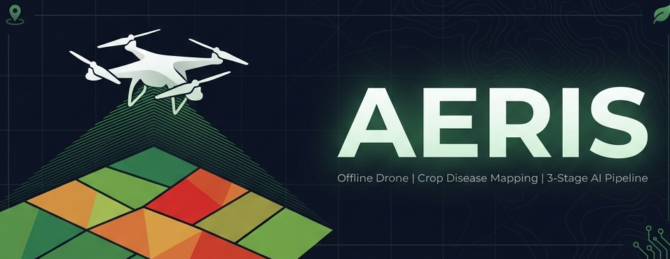
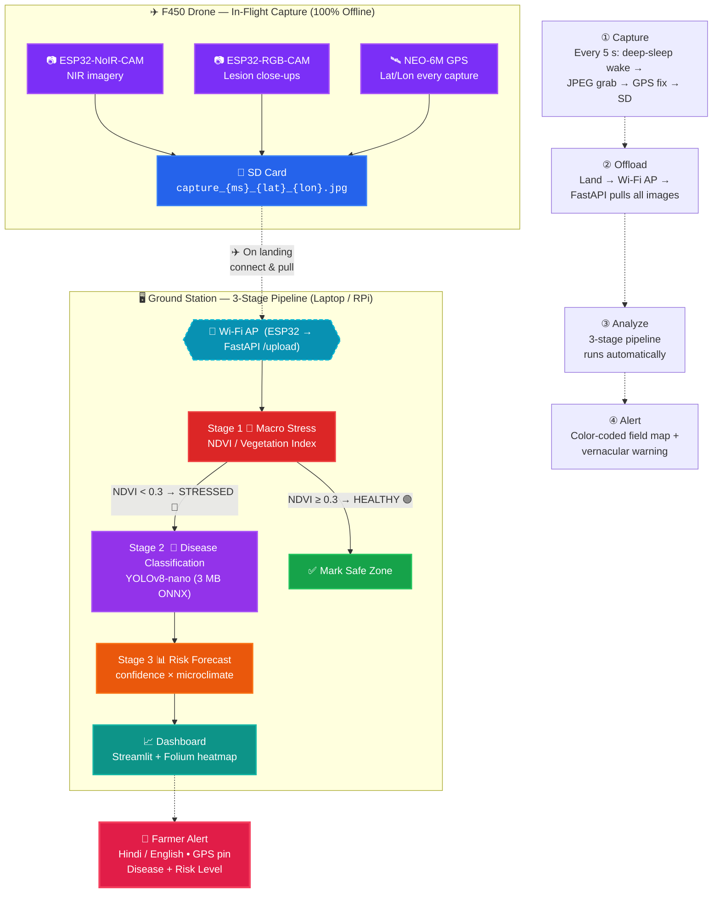
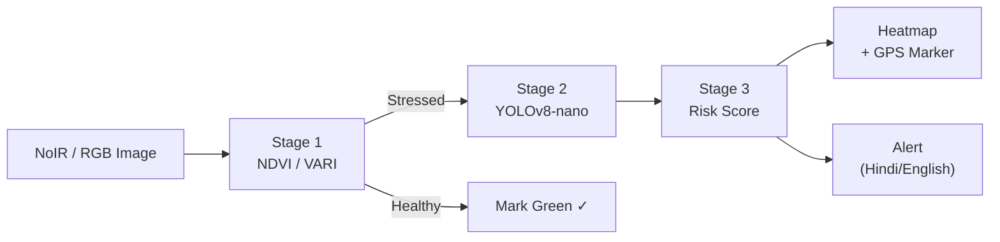

<p align="center">
  
</p>

<h1 align="center">Aeris</h1>

<p align="center">
  <b>Offline Multimodal Drone for Predictive Crop Disease Mapping</b>
</p>

<p align="center">
  <a href="#the-problem">Problem</a> · <a href="#how-it-works">How It Works</a> · <a href="#3-stage-pipeline">Pipeline</a> · <a href="#quick-start">Quick Start</a> · <a href="#repository-map">Repo Map</a> · <a href="#hardware-bom">Hardware BOM</a> · <a href="#demo">Demo</a> · <a href="#contributing">Contributing</a>
</p>

<p align="center">
  
  
  
  
  
</p>

---

## The Problem

Indian farmers lose **35% of crop yield** to pest and disease damage every year ([ICAR estimate](https://icar.org.in/)). Current detection methods fail them in three specific ways:

| Method | Why It Falls Short |
|---|---|
| **Satellite NDVI** (Sentinel-2, Landsat) | 10m/pixel resolution. Cannot identify individual diseased plants. Blocked by monsoon cloud cover for weeks. 5-day revisit cycle is too slow for blight outbreaks. |
| **Manual Scouting** | A farmer walks 2-3 acres/day at best. Disease in the center of a 10-acre field goes unnoticed until it has already spread. |
| **Cloud-based Drone Services** | Require stable 4G/5G connectivity. Rural India averages 3-5 Mbps with frequent dead zones. Subscription costs of Rs. 5,000-15,000/season are out of reach for smallholders. |

**Aeris closes this gap.** A sub-Rs.15,000 drone captures dual-spectrum imagery (Near-Infrared + RGB), flies back, dumps the data over local Wi-Fi, and a laptop runs the full diagnostic pipeline. No internet. No cloud. No subscription.

---

## How It Works

The system has two physical halves — the **drone** (airborne data collection) and the **ground station** (local analysis + alerting) — connected by Wi-Fi on landing, with zero internet dependency.



<small>**① Capture** — Every 5 s the ESP32 wakes from deep sleep, grabs a JPEG, reads the GPS fix, and writes `capture_{millis}_{lat}_{lon}.jpg` to SD. &nbsp;·&nbsp; **② Offload** — On landing the ESP32 starts a Wi-Fi AP; the ground station connects and pulls all images via FastAPI. &nbsp;·&nbsp; **③ Analyze** — Images enter the 3-stage pipeline (NDVI → YOLOv8 → Risk Score). &nbsp;·&nbsp; **④ Alert** — The dashboard renders a color-coded field map and fires a vernacular alert: *"Disease: Rice Leaf Blast. Risk is HIGH. Take action now."*</small>

---

## 3-Stage Pipeline

This is the core novelty. We do **not** rely on NDVI alone (it is noisy, weather-dependent, and cannot tell you *which* disease you are looking at). Instead, NDVI is just a trigger.

### Stage 1: Macro Anomaly Detection

**Input:** NoIR camera image (or RGB fallback)
**Method:** Extract the Red channel as NIR proxy, Blue channel as visible Red. Compute NDVI = `(NIR - Red) / (NIR + Red)`. For RGB-only images, fall back to VARI = `(Green - Red) / (Green + Red - Blue)`.
**Output:** Binary flag: `STRESSED` or `HEALTHY`. Threshold configurable (default NDVI < 0.3).

> NDVI tells you *something is wrong*. It does not tell you *what*. That is Stage 2's job.

### Stage 2: Micro Disease Classification

**Input:** RGB close-up of stressed zone
**Method:** YOLOv8-nano (3 MB ONNX model, ~15 FPS on CPU) trained on PlantVillage dataset via Roboflow. Performs bounding-box detection and classification of lesion patterns.
**Output:** Disease name + confidence score. Currently supports 12 classes:

```
Tomato Early Blight    │ Tomato Late Blight    │ Tomato Leaf Mold
Tomato Septoria        │ Tomato Spider Mites   │ Tomato Target Spot
Tomato Yellow Leaf Curl│ Potato Early Blight   │ Potato Late Blight
Rice Leaf Blast        │ Rice Brown Spot       │ Healthy
```

### Stage 3: Predictive Risk Forecasting

**Input:** Disease label + confidence + local microclimate readings (temperature, humidity)
**Method:** Weighted risk formula: `risk = 0.7 * confidence + 0.3 * env_factor`. Environmental penalties applied when temp > 30C or humidity > 80%.
**Output:** Risk score (0.0 - 1.0) and risk level (`NONE` / `LOW` / `MEDIUM` / `HIGH`), plus a vernacular alert in Hindi or English.



---

## Quick Start

### Prerequisites

- Python 3.10+
- pip
- (Optional) PlatformIO for flashing ESP32 firmware

### 1. Clone and Install

```bash
git clone https://github.com/AkashNaickar/Aeris.git
cd Aeris/ground_station
pip install -r requirements.txt
```

### 2. Run the Pipeline on a Sample Image

```bash
python scripts/run_pipeline.py --image ../data/sample_captures/test_ndvi.jpg
```

Output:
```
[Aeris] test_ndvi.jpg
  GPS: (28.613900, 77.209000)
  Stage 1 (Stress): STRESSED
  Stage 2 (Disease): Rice_Leaf_Blast (87.3%)
  Stage 3 (Risk): HIGH (0.79)
```

### 3. Launch the Dashboard

```bash
streamlit run src/aeris/dashboard/app.py
```

Open `http://localhost:8501`. Upload a drone image. Watch the map populate with disease markers.

### 4. (Optional) Seed Demo Data

```bash
python scripts/seed_demo_data.py
```

This generates sample GPS-tagged results so the heatmap is pre-populated for a demo walkthrough.

---

## Repository Map

```
Aeris/
├── firmware/                    # ESP32 embedded code
│   ├── esp32_nir_cam/           #   NoIR camera + GPS capture (PlatformIO)
│   ├── esp32_rgb_cam/           #   RGB camera + GPS capture (PlatformIO)
│   └── gps_neo6m/               #   NEO-6M standalone test sketch
│
├── ground_station/              # Python ground station (the brain)
│   ├── src/aeris/
│   │   ├── pipeline/
│   │   │   ├── orchestrator.py  #     Runs Stage 1 -> 2 -> 3 in sequence
│   │   │   ├── stage1_macro.py  #     NDVI / VARI computation
│   │   │   ├── stage2_micro.py  #     YOLOv8-nano disease classification
│   │   │   └── stage3_forecast.py#    Risk scoring + environmental fusion
│   │   ├── ingest/
│   │   │   ├── wifi_receiver.py #     FastAPI server for drone Wi-Fi offload
│   │   │   ├── sd_watcher.py    #     Watchdog for SD card hot-plug
│   │   │   └── exif_parser.py   #     Extract GPS from EXIF / filename
│   │   ├── geo/
│   │   │   ├── heatmap.py       #     Folium heatmap + GeoJSON export
│   │   │   └── projections.py   #     Coordinate utilities
│   │   ├── alerts/
│   │   │   └── vernacular.py    #     Hindi + English alert generation
│   │   ├── dashboard/
│   │   │   └── app.py           #     Streamlit dashboard (main UI)
│   │   └── config.py            #     Pydantic settings (single config source)
│   ├── scripts/
│   │   ├── run_pipeline.py      #     CLI entry point
│   │   └── seed_demo_data.py    #     Generate fake results for demo
│   ├── tests/                   #     Unit tests (pytest)
│   ├── requirements.txt
│   └── pyproject.toml
│
├── models/                      # Trained model weights
│   └── README.md                #   Instructions for downloading YOLOv8 ONNX
│
├── data/
│   ├── sample_captures/         # Example drone images for testing
│   └── plantvillage_subset/     # Training data subset (gitkeep only)
│
├── notebooks/                   # Jupyter notebooks for training + exploration
│
├── docs/
│   ├── ARCHITECTURE.md          # Pipeline design + Mermaid diagrams
│   ├── HARDWARE_WIRING.md       # Pin maps, power distribution, wiring
│   ├── DATASET.md               # PlantVillage dataset preparation
│   ├── DEMO_SCRIPT.md           # Step-by-step demo instructions
│   └── JUDGES_QUICKSTART.md     # 2-minute quickstart for reviewers
│
├── demo/
│   ├── DEMO_RUNBOOK.md          # Quick reference card for live demo
│   └── fake_disease_targets/    # Printable disease spot stickers
│
├── deployment/
│   ├── Dockerfile               # Containerized ground station
│   ├── docker-compose.yml       # One-command deployment
│   └── systemd/aeris.service    # Auto-start on Raspberry Pi boot
│
├── CONTRIBUTING.md
└── LICENSE                      # MIT
```

---

## Hardware BOM

Total estimated cost: **Rs. 12,000 - 15,000**

| Component | Qty | Approx. Cost (INR) | Purpose |
|---|---|---|---|
| F450 Drone Frame Kit | 1 | 3,500 | Airframe + motors + ESCs + props |
| KK 2.1.5 Flight Controller | 1 | 1,200 | Manual/stabilized flight control |
| ESP32-CAM (OV2640) | 1 | 500 | RGB image capture |
| ESP32-CAM NoIR (OV2640, no IR filter) | 1 | 600 | Near-infrared image capture |
| Red optical filter (gel) | 1 | 50 | Blocks visible light, passes NIR on NoIR cam |
| NEO-6M GPS Module | 1 | 300 | Geotagging each capture |
| 11.1V 3S LiPo Battery (2200mAh) | 1 | 1,500 | Drone power |
| MicroSD Card (16GB) | 2 | 400 | On-board image storage |
| Jumper wires + BEC | misc | 200 | Power regulation, connections |
| **Total** | | **~8,250** | *Excluding transmitter/receiver* |

> **Note:** If you already own an RC transmitter + receiver (FlySky i6 or similar), total cost drops significantly. The ground station runs on any laptop with Python 3.10+.

---

## Tech Stack

| Layer | Technology | Why |
|---|---|---|
| Firmware | Arduino + ESP-IDF, TinyGPS++, SD_MMC | Proven libraries for ESP32-CAM. Deep sleep draws <10uA between captures. |
| Vision | OpenCV 4.8+, NumPy | NDVI/VARI pixel math. No heavy dependencies. |
| Detection | YOLOv8-nano (Ultralytics), ONNX Runtime | 3 MB model. Runs at 15 FPS on CPU-only hardware. No GPU needed. |
| Ingestion | FastAPI, python-multipart, watchdog | Async HTTP receiver for Wi-Fi offload. Watchdog for SD card hot-plug. |
| Config | Pydantic Settings | One `.env` file controls all thresholds, paths, and camera params. |
| Mapping | Folium, streamlit-folium | Interactive maps with OpenStreetMap tiles (cached offline). |
| Dashboard | Streamlit | Prototype to production-quality UI in hours, not days. |
| Deployment | Docker, systemd | One-command setup on Raspberry Pi or any Linux box. |

---

## Demo

### End-to-End Flow (~2 minutes)

| Step | What Happens | Time |
|---|---|---|
| 1 | Power on drone, wait for GPS fix (blue LED solid) | 30s |
| 2 | Manual flight over a pre-marked grid (or tethered hover) | 60s |
| 3 | Land. Drone creates Wi-Fi AP. Ground station auto-connects and pulls images. | 10s |
| 4 | Pipeline runs: NDVI -> YOLOv8 -> Risk Score | 5s |
| 5 | Dashboard map fills with red/green markers | 2s |
| 6 | Hindi alert appears on screen | 5s |

### Software-Only Mode

If drone hardware is not available, you can test the full pipeline on saved images:

```bash
python scripts/run_pipeline.py --image ../data/sample_captures/rice_blast.jpg
streamlit run src/aeris/dashboard/app.py
```

### Physical Test Setup

A potted plant with printed "disease spot" stickers (templates in `demo/fake_disease_targets/`) works well for testing the RGB camera classification in real time.

---

## Configuration

All settings live in a single file and can be overridden via environment variables:

```bash
# .env (place in ground_station/)
AGRISCOUT_NDVI_THRESHOLD=0.3
AGRISCOUT_VARI_THRESHOLD=0.2
AGRISCOUT_YOLO_MODEL_PATH=models/yolov8n_aeris.onnx
AGRISCOUT_YOLO_CONFIDENCE=0.5
AGRISCOUT_RISK_TEMP_HIGH=30.0
AGRISCOUT_RISK_HUMIDITY_HIGH=80.0
AGRISCOUT_ALERT_LANGUAGE=hindi
```

---

## Why Not Just NDVI?

This is the most common question people ask. Here is the short answer:

NDVI tells you a plant is stressed. It does not tell you *why*. A low NDVI reading could mean nitrogen deficiency, water stress, fungal blight, or insect damage. A farmer who sprays fungicide on a nitrogen-deficient field wastes money and harms the soil.

The approach here: use NDVI as a **cheap, fast trigger** (Stage 1) to narrow down which zones need closer inspection. Then send in the RGB camera at low altitude and let a convolutional neural network (Stage 2) perform the actual diagnosis based on lesion shape, color, and texture. Finally, factor in weather conditions (Stage 3) to predict whether the disease will spread.

NDVI is 10% of the system. The CNN is the diagnostic engine.

---

## Roadmap

- [ ] Autonomous waypoint flight via ArduPilot/PX4
- [ ] Multispectral camera upgrade (RedEdge-style 5-band)
- [ ] On-device inference using ESP32-S3 + TFLite micro
- [ ] WhatsApp/SMS alert delivery via Twilio
- [ ] Multi-field aggregation dashboard for FPOs (Farmer Producer Organizations)
- [ ] Integration with government soil health card data

---

## Author

Built by [Akash Naickar](https://github.com/AkashNaickar).

---

## License

[MIT](LICENSE)
