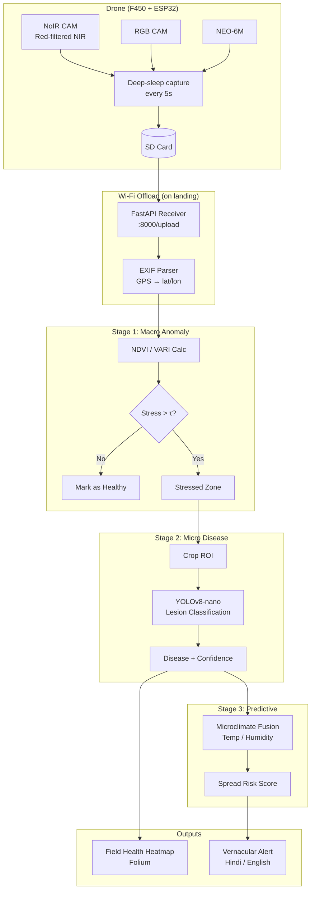

# Architecture — 3-Stage Pipeline

## Key Design Decisions

| Decision | Rationale |
|----------|-----------|
| NDVI as trigger only | Avoids over-reliance on vegetation indices; CNN handles final diagnosis |
| Offline Wi-Fi offload | No cellular dependency — ESP32 creates AP on landing |
| YOLOv8-nano + ONNX | 3 MB model runs at 15 FPS on CPU-only laptop |
| Pydantic Settings | Single source of truth for thresholds, paths, camera params |
| Streamlit + Folium | Rapid dashboard prototyping with free offline tile layers |
